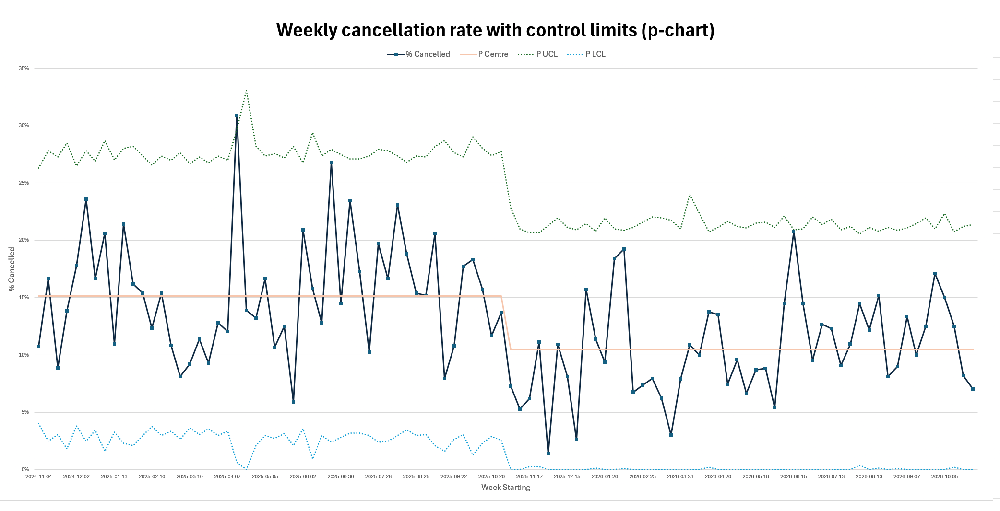
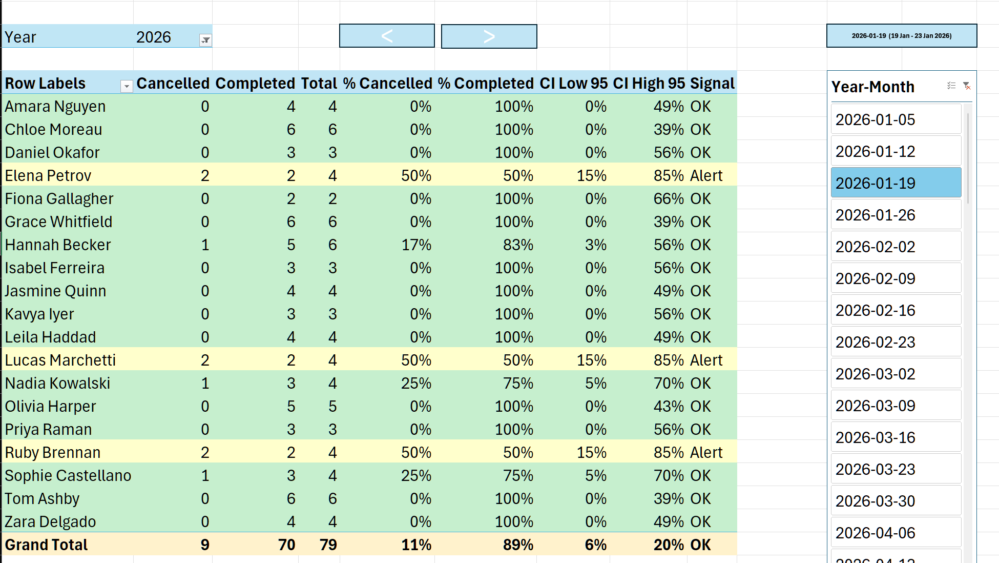
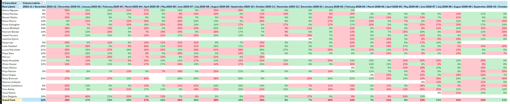
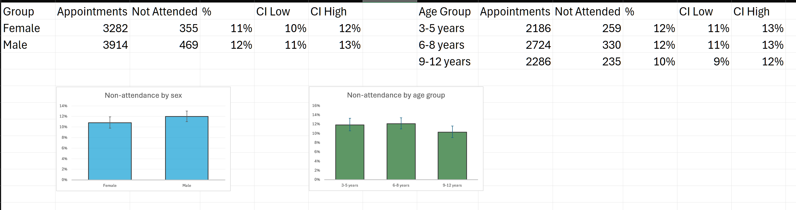

# Clinic appointment cancellations: an Excel reporting project

> **All data in this repository are synthetic.** The appointment exports and the age/sex file were generated, with the help of an AI assistant, to have the same structure as a practice-management (Zanda) export from a paediatric play-therapy clinic. No real patients, families or staff are included.
>
> **The SMS reminders are a hypothetical scenario.** The simulated data include a change on 3 November 2025, described as the start of SMS appointment reminders, so that the report can show how a before/after change is detected. It does not describe a real clinic event.

A routine operational task, the weekly and monthly cancellation report, built in Excel with Power Query, Power Pivot (DAX) and VBA, and extended with basic statistical methods: confidence intervals, control limits and a p-chart.

📄 **[Read the report → REPORT.md](REPORT.md)**



## Key results (synthetic data)

| | |
|---|---|
| Data | 7,313 appointments · 104 weeks (Nov 2024 – Oct 2026) · 684 children · 25 therapists |
| Overall cancellation rate | 12.9% (95% CI 12.1–13.7%) |
| Before vs after SMS reminders (hypothetical, 3 Nov 2025) | p-chart centre line 15.2% → 10.5% |
| Unusual weeks | one week above the upper control limit: 14 Apr 2025 (Easter + school holidays, about 31%) |
| Girls vs boys | 10.8% (9.8–11.9%) vs 12.0% (11.0–13.0%) |
| Age groups | 3–5 years 11.8%, 6–8 years 12.1%, 9–12 years 10.3% (all CIs overlap) |

## What is in the workbook

`excel/Clinic_Cancellations_Report.xlsm` (enable macros for the buttons and automatic updates)

| Sheet | What it shows |
|---|---|
| **Data** | All 24 monthly exports combined by a Power Query folder query, with helper columns (Start of Week, Month Name, Year-Month, Cancelled_Completed) |
| **Weekly 2026** | Cancelled / completed / % per therapist for one week, with cancellation reasons; rows over 20% in orange. Navigate with the slicer or the < > buttons |
| **Uncertaintly_Weekly** | The same week with 95% confidence intervals and a Signal (OK / Alert / Alarm / Low) |
| **Monthly 2026** | The monthly version of the weekly report |
| **Uncertaintly_Monthly** | Monthly rates with confidence intervals and Signal |
| **HeatMap** | Therapist × month rates: red if higher than the previous month, green if not |
| **Uncertaintly** | Clinic-wide value of every uncertainty measure, with explanations |
| **Clients** | Age and sex for every child, with appointments and non-attendance per child |
| **Age_Sex_Summary** | Non-attendance by sex and age group with 95% CIs and charts |
| **P-Chart** | Weekly cancellation rate with centre line and 3-sigma control limits |

## Screenshots

**Weekly report with confidence intervals and Signal** (Uncertaintly_Weekly): rows coloured OK / Alert / Alarm



**Month-to-month heat map** (HeatMap): red = higher than the previous month, green = same or lower



**Non-attendance by sex and age group** (Age_Sex_Summary): 95% confidence intervals shown as error bars



## Repository layout

```
├── README.md
├── REPORT.md                         write-up: data, methods, results, limitations
├── excel/
│   └── Clinic_Cancellations_Report.xlsm
├── data/
│   ├── zanda_exports/                24 monthly CSV exports (the Power Query source folder)
│   └── Zanda_Client_Age_Sex.csv      age and sex per child (loaded into the Clients sheet)
├── powerquery/
│   └── Appointments.pq               the folder query (M code)
├── dax/
│   ├── measures.dax                  Total, Cancelled, Completed, % Cancelled, reasons
│   └── measures_uncertainty.dax      CI Low/High, Clinic %, Z Score, limits, Signal, p-chart
├── vba/                              VBA exported from the workbook
│                                     (.bas = module, .cls = class or sheet module)
└── images/                           screenshots used in this README and the report
```

The Power Query, DAX and VBA code is also saved as plain text, so it can be read without opening Excel.

## Data dictionary (appointment export)

| Column | Description |
|---|---|
| Client Name | Child's name (synthetic) |
| Therapist | Treating therapist |
| Date | Appointment date and start time (dd/mm/yyyy h:mm AM/PM) |
| End Time | Appointment end time |
| Day | Weekday |
| Appointment Type | Initial Assessment, Ongoing Session, Parent Review, Discharge Review |
| Type of Play Therapy | Child-Centred, Theraplay, Sandtray, Filial, Art-Based, Cognitive Behavioural Play Therapy |
| Duration (min) | 50, 60 or 90 |
| Status | Completed, Cancelled, Rescheduled, No Show |
| Reason for Cancellation | Blank when completed |

`Zanda_Client_Age_Sex.csv`: Client Number, Client Name, Date of Birth, Sex, Age at Referral, First Appointment, Age at First Appointment, Age Group.

## How to open it

1. Download or clone the repository.
2. Open `excel/Clinic_Cancellations_Report.xlsm` and click **Enable Content**.
3. To refresh from the CSV files, point the Power Query folder path to your copy of `data/zanda_exports/` (**Data ▸ Queries & Connections ▸ Edit ▸ Source**), then **Data ▸ Refresh All**.

## Privacy

No real data are included and none should be committed. With real data, sex, age and name together can identify a child in a small clinic, so any published table should suppress small groups (fewer than 5 children or 5 events).

## License

MIT (see `LICENSE`).
