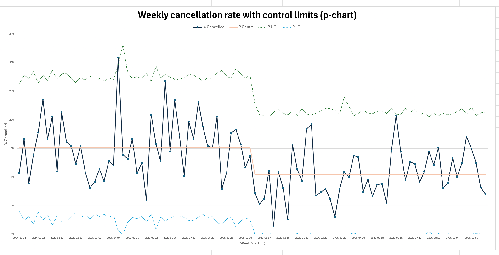
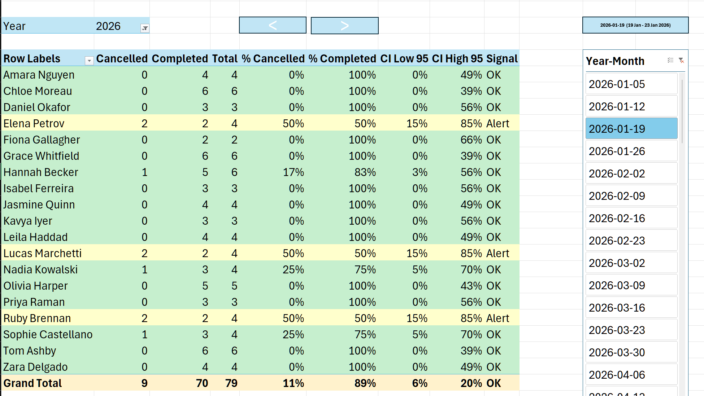
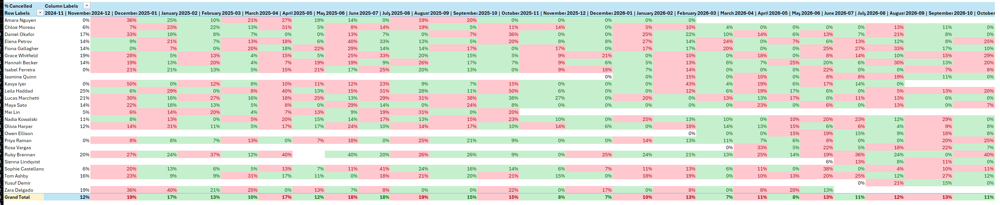
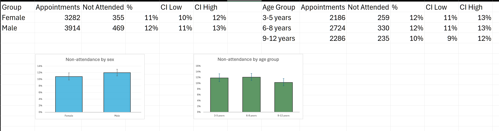

# Appointment cancellations in a paediatric play-therapy clinic: an Excel reporting project

**Data:** synthetic (simulated) appointment records, generated with the help of an AI assistant to match the structure of a real practice-management export (Zanda). No real patients, families or staff are included.
**Scenario:** the SMS reminders starting on 3 November 2025 are hypothetical. The change was built into the simulated data to show how a before/after change is detected; it is not a real clinic event.
**Period:** 4 November 2024 – 30 October 2026 (104 weeks)
**Tools:** Excel Power Query (M), Power Pivot (DAX), VBA, PivotTables and PivotCharts, worksheet formulas

---

## 1. Summary

The clinic needed a weekly and monthly view of cancellations by therapist. I built an Excel report that combines the monthly Zanda exports automatically, shows each therapist's cancellations and reasons for any week or month, and updates when a slicer is clicked.

A simple rule ("orange if more than 20% cancelled", "red if higher than last month") flags many therapists who differ only by chance, because each therapist sees few children per week. I therefore added confidence intervals, control limits and a p-chart, so that the report separates real changes from normal variation.

Main findings (synthetic data):

1. **The overall cancellation rate was 12.9%** (941 of 7,313 appointments; 95% CI 12.1–13.7%).
2. **Cancellations fell after the (hypothetical) introduction of SMS reminders on 3 November 2025.** The p-chart centre line drops from 15.2% to 10.5%, and the change persists for the whole second year, a shift in the process rather than a one-week blip. This is a before/after comparison without a control group, so other changes at the same time cannot be ruled out.
3. **Only one week was outside the control limits:** the week of 14 April 2025 (Easter and school holidays), at about 31%. All other weekly rates were within the range expected from chance.
4. **Most single-week "problems" are noise.** Therapists typically have 2–6 appointments a week, so one cancellation moves a rate from 0% to 20–50%, and 95% confidence intervals are often wider than 40 percentage points. With control limits, most therapist-weeks are OK, and Alerts are rare.
5. **Age and sex made little difference.** Non-attendance was 10.8% for girls and 12.0% for boys, and 10.3–12.1% across age groups, with overlapping confidence intervals.

## 2. Data

### 2.1 Appointment exports

Twenty-four monthly CSV files (`data/zanda_exports/`), one per month, with the columns described in the README. Each row is one booked appointment.

- **Cancelled** = any status other than Completed (Cancelled, Rescheduled, No Show). This is the column *Cancelled_Completed*.
- Dates are exported as text in Australian format (dd/mm/yyyy), so Power Query parses them with the English (Australia) locale into a separate *DateParsed* column.

### 2.2 Client file (age and sex)

`data/Zanda_Client_Age_Sex.csv` has one row per child: date of birth, sex, age at referral, first appointment, age at first appointment and age group (3–5, 6–8, 9–12 years). It is loaded as a separate table (*Clients*) and is not added to the Data Model, so the main report is unaffected.

## 3. Methods

### 3.1 Data preparation (Power Query)

A folder query reads every CSV in `data/zanda_exports/`, combines them, and adds helper columns: DateParsed, Start of Week (Monday), Year-Month (week label), Month Name, Month Label, Quarter Label and Cancelled_Completed. Adding a new month only requires dropping the new CSV into the folder and clicking **Refresh All**.

### 3.2 Measures (Power Pivot / DAX)

- **Total, Cancelled, Completed, % Cancelled, % Completed** and the list of cancellation reasons (`dax/measures.dax`).
- **Uncertainty measures** (`dax/measures_uncertainty.dax`):
  - **CI Low 95 / CI High 95:** Wilson 95% confidence interval for % Cancelled. Wilson intervals behave well with small numbers and rates near 0%.
  - **Clinic %:** the clinic-wide rate for the same week or month (the benchmark).
  - **Z Score:** (therapist rate − clinic rate) / √(clinic rate × (1 − clinic rate) / n).
  - **Upper Limit 95 / 99.8:** clinic rate + 1.96 or 3.09 standard errors.
  - **Signal:** Alarm if Z > 3.09, Alert if Z > 1.96, Low if Z < −1.96, otherwise OK.
  - **P Centre, P UCL, P LCL:** centre line and 3-sigma limits for the weekly p-chart. The centre line is calculated separately before and after the hypothetical SMS reminder start.

### 3.3 Reports (PivotTables and VBA)

- Weekly and monthly pivots per therapist, navigated with a slicer or < > buttons. VBA keeps the period box, slicer and buttons in place and recolours the rows each time the slicer changes (`vba/`).
- The *Uncertaintly* sheets colour each row by Signal: OK green, Alert light yellow, Alarm light red.
- The *HeatMap* sheet colours each therapist-month red if the rate rose from the previous month, otherwise green.
- The *P-Chart* sheet plots the weekly rate with its centre line and control limits.

### 3.4 Age and sex (worksheet formulas)

COUNTIFS on the *Clients* sheet counts each child's appointments and non-attended appointments, excluding therapist illness (not the family's choice). SUMIFS totals them by sex and age group, and a LET formula gives the Wilson 95% CI.

## 4. Results

### 4.1 Overall

| | Value |
|---|---|
| Appointments | 7,313 |
| Cancelled (not completed) | 941 |
| % Cancelled (95% CI) | 12.9% (12.1–13.7%) |

### 4.2 Trend and SMS reminders (hypothetical)

The weekly rate moves around its centre line from week to week. The centre line is 15.2% before SMS reminders and 10.5% after them. After the change, every week stays within the control limits. One week before the change, 14 April 2025, is above the upper limit (about 31%), which matches Easter and the school holidays.

### 4.3 Therapists

In a typical week, therapists have 2–6 appointments, so a single cancellation gives a rate of 17–50%. Under the 20% rule such therapists turn orange, but their confidence intervals are wide (for example 0% to 50% or more) and their Signal is usually OK. An Alert in one week is expected about once in every 40 therapist-weeks by chance. A therapist who shows Alerts in several weeks is more meaningful.

### 4.4 Month-to-month heat map

"Higher than last month" turns roughly half the cells red, because monthly rates rest on 10–30 appointments and move several points by chance. The heat map is useful for spotting patterns, such as one therapist red for several months in a row or a whole month red across the clinic, but not for judging single cells.

### 4.5 Age and sex

Therapist illness excluded (7,196 appointments).

| Group | Appointments | Not attended | % (95% CI) |
|---|---|---|---|
| Female | 3,282 | 355 | 10.8 (9.8–11.9) |
| Male | 3,914 | 469 | 12.0 (11.0–13.0) |
| 3–5 years | 2,186 | 259 | 11.8 (10.6–13.3) |
| 6–8 years | 2,724 | 330 | 12.1 (10.9–13.4) |
| 9–12 years | 2,286 | 235 | 10.3 (9.1–11.6) |

All confidence intervals overlap. These intervals treat each appointment as independent, but the same child has many appointments, so the true uncertainty is somewhat larger. The differences are small, so support is better aimed at families with a history of missed sessions than at an age or sex group.

## 5. Recommendations for the clinic

1. **Check changes before and after, as here.** In this scenario the rate stayed lower after SMS reminders started. The same p-chart with separate centre lines applies to any real change, such as a new booking or cancellation policy.
2. **Use the Signal column rather than the 20% rule** when discussing therapists, and look for repeated Alerts rather than single weeks.
3. **Use the p-chart for the whole clinic.** Investigate only weeks outside the control limits, and expect higher cancellations in school holidays.
4. **Plan for holiday periods,** for example with a waitlist to fill slots that families release.

## 6. Limitations

- **The data are synthetic.** The results show how the report and methods work, not real clinic performance. The SMS reminder change was built into the simulated data, so detecting it is a check of the method, not a finding.
- The SMS comparison is before/after with no control group, and seasonal patterns differ between the two years.
- Rescheduled appointments are counted as cancelled, and make-up sessions are not tracked.
- Confidence intervals and limits assume appointments are independent. Repeated appointments by the same child make the real uncertainty larger.
- Control limits flag about 1 in 40 therapist-weeks at the 95% level by chance, so some Alerts will always be false alarms.

## 7. Skills shown

| Skill | Where |
|---|---|
| Data preparation | Power Query folder query, date parsing with locale, helper columns |
| Data modelling | Power Pivot Data Model and DAX measures |
| Automation | VBA: navigation buttons, automatic recolouring, event handling |
| Statistics for monitoring | Wilson confidence intervals, z-scores, control limits, p-chart |
| Linking data sources | Client age/sex table joined by client name with COUNTIFS/SUMIFS |
| Communication | Report sheets with explanations for non-statistical staff, and this write-up |
| Data privacy | Synthetic data only; small-group suppression noted for real use |
